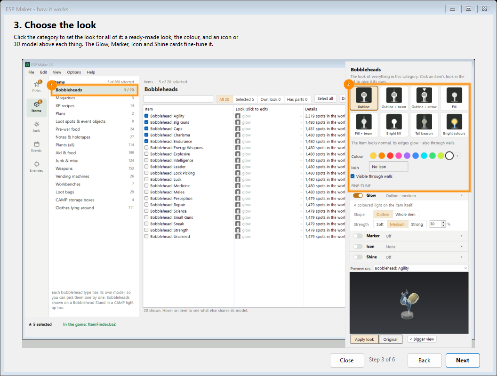

# ESP Maker

Make your own ESP mod for **Fallout 76** without editing any files.



Choose what you want to spot: bobbleheads, magazines, plans, XP food, pre-war food, notes, plants (including the nuked flora for Stable Flux), loot, loot bags, CAMP storage boxes, clothes, every outfit and armor piece (on the ground or worn), event objects, player vending machines, workbenches, legendary enemies or any kind of creature. Then choose how it looks:

- an outline or full glow, or just brighter colours - optionally seen through walls (X-ray)
- or Invisible: the item disappears and only what you add shows (it also hides foliage and worn outfits)

Above the item you stack layers in any order: a beam into the sky, an arrow, a flat icon or a small 3D model, a copy of the item itself, and a floating name label. Each layer has its own colour, strength and size, and effects: X-ray, rainbow colours, pulse, spin, bob, light running up the beam, and a timer that hides it after a set time.

The app speaks all 13 of the game's languages (**View → Language**). Item, enemy and category names come from your game's own text. The window text was translated with AI help, so some wording may be off; corrections are welcome.

**Pickup range** (on things you can pick up) puts an invisible ball around the item, so you can take it from up to 15 m away. It is off unless you turn it on. Use it at your own risk: it lets you take things from further away than the game normally allows, and the game's servers can see that.

ESP Maker builds the mod (`.ba2`) and installs it for you. It only changes files on your own PC. The result is a normal `.ba2` mod listed in your custom ini, like any other Fallout 76 mod.

**Item fixes online (only if you allow it):** the app asks once whether it may check this repository at start for [rules/rules.json](rules/rules.json). That file lists which models belong to which enemy, event and item, so fixes arrive without a new version. It downloads only that file and sends nothing. You can change this in **Options**.

## Download

Get the ready-to-run app from the [Releases](../../releases) page or from Nexus Mods. You don't need to build it yourself.

**Requirements:** Windows 10 or 11 (64-bit) and Fallout 76 on PC (Steam, or the Microsoft Store / PC Game Pass version). Mods don't work on consoles.

## How to use

1. Unzip anywhere and start `ESP Maker.exe`. If Windows shows "Windows protected your PC", click **More info → Run anyway** (the app isn't signed with a paid certificate).
2. Pick a section in the bar on the far left, then a category, or search (Ctrl+K jumps anywhere). Select what you want to find.
3. Click the category (or an item) to choose its look in the pop-up: start from a preset, then **+ Add on top** to stack layers above the item. The 3D preview beside it shows the real game model the way the mod will show it: turn it, zoom, walk around it, and add a person, a house, a wall or a shed to test it.
4. Close the game, click **Build & save**, name your mod, click **Build**, then start the game.

**Edit → Add presets...** adds common setups in one click: enemies, legendary enemies, bobbleheads, magazines, plans, XP buffs, player vendors and more. **Import .ba2...** opens an existing mod (yours or someone else's) so you can change it or merge it with another. **Options → Mod manager** (or the **Mods** button) turns any of your mods on or off, changes the load order and shows which mods change the same files. **Install mod...** (or drag a downloaded .zip / .7z / .rar / .ba2 onto the list) puts a downloaded mod into Data for you. If **Vortex** manages your mods, Build & save and Install mod... hand the mod to Vortex instead, so Vortex keeps it in the game's mod list (its deploys drop mods copied in by hand).

The full guide, with limits and tips, is in [release-files/README.txt](release-files/README.txt). The version history is in [release-files/CHANGELOG.txt](release-files/CHANGELOG.txt).

## Good to know

- Changes show after you restart the game.
- The game highlights 3D models, not items, so things that share a model light up together.
- Only things lying in the world can glow. Loot inside containers and bodies can't.
- Your settings and setups are kept in `%AppData%\ESP Maker`.

## Building from source

You need the [.NET 8 SDK](https://dotnet.microsoft.com/download/dotnet/8.0) on Windows.

Dev build (includes the test command-line modes):

```
dotnet build src -c Release
```

Release build (one self-contained exe, without the dev tools):

```
dotnet publish src -c Release -r win-x64 --self-contained true -p:PublishSingleFile=true -p:IncludeNativeLibrariesForSelfExtract=true -p:DevTools=false
```

The app is written in C# with WinForms. It reads the game's own `.ba2` archives and patches the `.nif` models and materials itself. It needs no other tools.

## Bug reports

If something goes wrong, the app writes `%AppData%\ESP Maker\error.log`. Please open an issue, attach that file, and describe what you did.

## License

[MIT](LICENSE). You can use, change and share the code freely; just keep the copyright notice.
