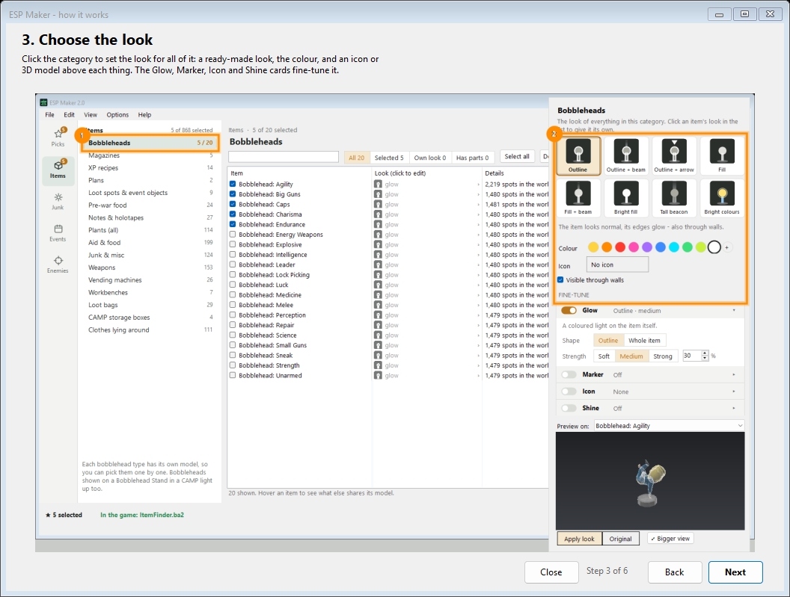

# ESP Maker

Make your own ESP mod for **Fallout 76** without editing any files.



Choose what you want to spot: bobbleheads, magazines, plans, XP food, pre-war food, notes, plants, loot, loot bags, CAMP storage boxes, clothes, every outfit and armor piece (on the ground or worn), event objects, player vending machines, workbenches, legendary enemies or any kind of creature. Then choose how it looks:

- an outline or full glow, which also shows through walls
- a beam into the sky (or an arrow)
- a flat icon or a small 3D model above it
- a floating name label
- just brighter colours
- or Invisible: the item disappears and only the beam, icon or name you add shows (it also hides foliage and worn outfits)

Each part can have effects: rainbow colours, pulse, spin, bob, light running up the beam, and a timer that hides it after a set time.

ESP Maker builds the mod (`.ba2`) and installs it for you. It only changes how things look on your own PC. The result is a normal `.ba2` mod listed in your custom ini, like any other Fallout 76 mod.

## Download

Get the ready-to-run app from the [Releases](../../releases) page or from Nexus Mods. You don't need to build it yourself.

**Requirements:** Windows 10 or 11 (64-bit) and Fallout 76 on PC (Steam, or the Microsoft Store / PC Game Pass version). Mods don't work on consoles.

## How to use

1. Unzip anywhere and start `ESP Maker.exe`. If Windows shows "Windows protected your PC", click **More info → Run anyway** (the app isn't signed with a paid certificate).
2. Pick a section in the bar on the far left, then a category, or search (Ctrl+K jumps anywhere). Select what you want to find.
3. Click the category (or an item) to choose its look in the pop-up. The 3D preview shows the real game model the way the mod will show it; **Bigger view** lets you walk around it.
4. Close the game, click **Build & save**, name your mod, click **Build**, then start the game.

**Edit → Add presets...** adds common setups in one click: enemies, legendary enemies, bobbleheads, magazines, plans, XP buffs, player vendors and more. **Import .ba2...** opens an existing mod (yours or someone else's) so you can change it or merge it with another.

The full guide, with limits and tips, is in [release-files/README.txt](release-files/README.txt). The version history is in [release-files/CHANGELOG.txt](release-files/CHANGELOG.txt).

## Good to know

- Changes show after you restart the game.
- The game highlights 3D models, not items, so things that share a model light up together.
- Only things lying in the world can glow. Loot inside containers and bodies can't.
- Your settings and setups are kept in `%AppData%\ESP Maker`.

## Building from source

You need the [.NET 8 SDK](https://dotnet.microsoft.com/download/dotnet/8.0) on Windows.

Dev build (includes the test command-line modes):

```
dotnet build src -c Release
```

Release build (one self-contained exe, without the dev tools):

```
dotnet publish src -c Release -r win-x64 --self-contained true -p:PublishSingleFile=true -p:IncludeNativeLibrariesForSelfExtract=true -p:DevTools=false
```

The app is written in C# with WinForms. It reads the game's own `.ba2` archives and patches the `.nif` models and materials itself. It needs no other tools.

## Bug reports

If something goes wrong, the app writes `%AppData%\ESP Maker\error.log`. Please open an issue, attach that file, and describe what you did.

## License

[MIT](LICENSE). You can use, change and share the code freely; just keep the copyright notice.
